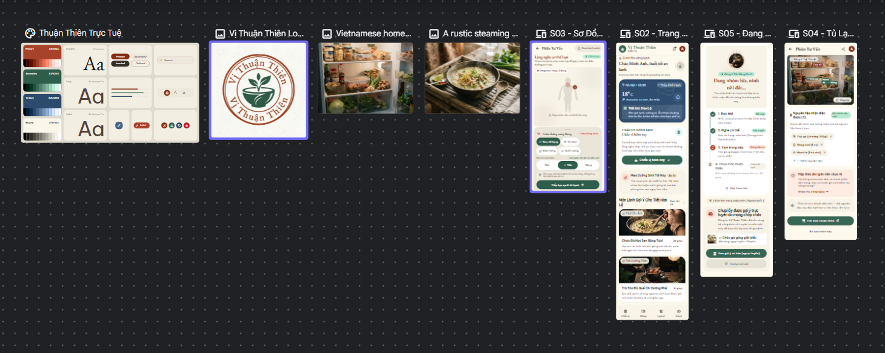
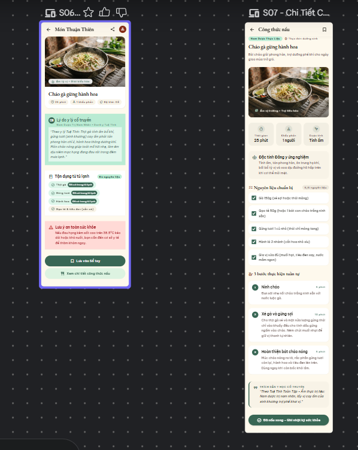
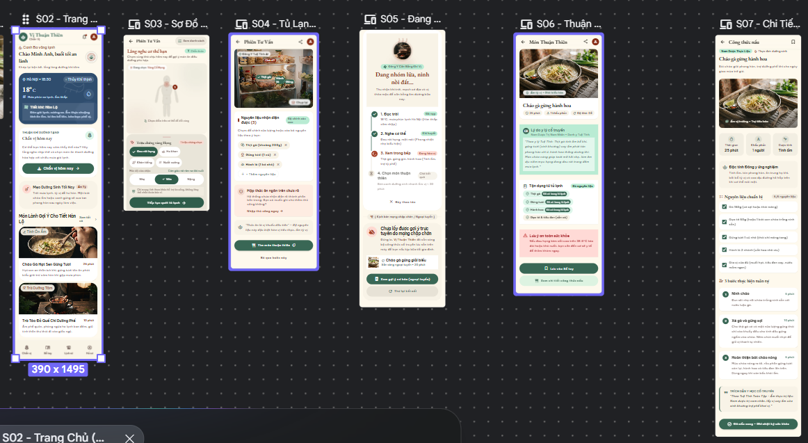

Design the user flow "Chẩn vị → Món Thuận Thiên" for the Android app "Vị Thuận Thiên" (360x800 dp, Material 3, light theme, all UI copy in Vietnamese). Persona: Minh Anh, 25, office worker in Hanoi, one-handed use, cold rainy evening, mild sore throat, fridge has chicken, ginger, spring onion. Goal: get 1-2 dish suggestions in under 6 taps after login.

Style: background #FBF6EA, surface #FFFDF7, primary #2F5D4B (white text), container #DDEBE3, chips #EADFC6, brick #A7432A, gold #C98B1F (dark text #262A26), indigo #2C4A6B, error #B3261E, text #262A26, muted #5E6258, outline #7A7E72. Noto Serif Bold headings, Be Vietnam Pro body >= 14 sp. Radius 12/20, 16 dp margins, touch targets >= 48 dp, one primary action per screen, never color alone for state, calm non-alarming copy.

PART 1 - Entry:
S01 Đăng nhập: fields "Tên đăng nhập", "Mật khẩu", Filled "Đăng nhập", Text "Quên mật khẩu?" (goes to S15), Text "Đăng ký" (goes to S14), Outlined "Tiếp tục với Google". Success goes to S02.
S14 Đăng ký: fields "Tên hiển thị", "Email", "Tên đăng nhập", "Mật khẩu", "Nhập lại mật khẩu", Filled "Tạo tài khoản". Success goes to S02.
S15 Quên mật khẩu: field "Email", Filled "Gửi liên kết", then success message and "Quay lại đăng nhập" (goes to S01).

PART 2 - Main flow:
S02 Trang chủ: weather card, solar-term card, ONE Filled button "Chẩn vị hôm nay" (goes to S03), bell icon, bottom navigation (Trang chủ, Sổ tay, Lịch sử, Hồ sơ).
S03 Sơ đồ thể trạng: body silhouette, selected region with fill + outline + dot + label, bottom sheet with symptom chips and Nhẹ/Vừa/Nặng, Switch "Xem dạng danh sách", Filled "Xong" (goes to S04).
S04 Tủ lạnh Thuận Thiên: ingredient chips (gà, gừng, hành lá), one marked "Chưa chắc chắn", Filled "Tiếp tục" (goes to S05), Text "Bỏ qua bước này" (goes to S05).
S05 Đang xử lý AI: clay pot illustration, 4-step stepper "Đọc trời", "Nghe cơ thể", "Xem trong bếp có gì", "Chọn món thuận thiên", progress bar, Text "Huỷ" (back to S04). Success goes to S06; failure shows error with "Thử lại" and "Xem gợi ý cơ bản (ngoại tuyến)".
S06 Thuận Thiên Món: dish card, chip "Vì sao gợi ý món này", ingredients from the fridge, safety note, Filled "Lưu vào Sổ tay", Text "Xem công thức" (goes to S07).
S07 Công thức: ingredients, numbered steps, source line "Nguồn: <tên sách, chương/trang>", Filled "Bắt đầu nấu".

Design the user flow "Quản lý Sổ tay" for the Android app "Vị Thuận Thiên" (360x800 dp, Material 3, light theme, all UI copy in Vietnamese). Persona: Minh Anh, 25, office worker, one-handed use. Goal: filter saved dishes, edit a note and rating, delete with a chance to undo.

Style: background #FBF6EA, surface #FFFDF7, primary #2F5D4B (white text), container #DDEBE3, chips #EADFC6, gold #C98B1F (dark text #262A26), error #B3261E, text #262A26, muted #5E6258, outline #7A7E72. Noto Serif Bold headings, Be Vietnam Pro body >= 14 sp. Radius 12/20, 16 dp margins, touch targets >= 48 dp, one primary action per screen, never color alone for state, calm copy.

S08 Sổ tay (tab 2, bottom navigation with Sổ tay selected): top app bar with sort icon, scrollable filter chips (Tất cả, Đau họng, Lạnh bụng, Mệt mỏi), saved dish cards (thumbnail, title max 2 lines, one-line note, star rating, date), min card height 72 dp. Tapping a card goes to S09.
S08 states: S08-Loading (3 skeleton cards), S08-Empty (icon, "Sổ tay còn trống. Sau khi chẩn vị, lưu món bạn thích vào đây.", Filled "Bắt đầu chẩn vị"), S08-Error (friendly message, "Thử lại"), S08-UndoSnackbar (Snackbar "Đã xoá. Hoàn tác").
S09 Chi tiết Sổ tay: back arrow, header image, multiline note field with character counter, 5-star rating, Filled "Lưu", Text "Xoá" in error color. Tapping "Xoá" opens S09-DeleteDialog: "Xoá món này khỏi Sổ tay?" with Filled "Xoá" in error color and Text "Huỷ" (back to S09). Confirming deletes and returns to S08 with the Undo Snackbar.

Design the user flow "Báo cáo và thông báo" for the Android app "Vị Thuận Thiên" (360x800 dp, Material 3, light theme, all UI copy in Vietnamese). Persona: Minh Anh, 25, office worker, one-handed use. Goal: export a weekly PDF report, review history, and open a notification to the right screen.

Style: background #FBF6EA, surface #FFFDF7, primary #2F5D4B (white text), container #DDEBE3, chips #EADFC6, gold #C98B1F (dark text #262A26), error #B3261E, text #262A26, muted #5E6258, outline #7A7E72. Noto Serif Bold headings, Be Vietnam Pro body >= 14 sp. Radius 12/20, 16 dp margins, touch targets >= 48 dp, one primary action per screen, never color alone for state, calm copy.

S12 Hồ sơ và Cài đặt (tab 4): avatar, name, email, "Dị ứng và kiêng kỵ" input chips, "Cỡ chữ" segmented button (Nhỏ, Vừa, Lớn), list item "Xuất báo cáo PDF" (goes to S13), Outlined "Đăng xuất", collapsed "Công cụ thử nghiệm".
S13 Xuất báo cáo PDF: back arrow, weekly report preview card, Filled "Xuất PDF", Text "Xem dữ liệu trong báo cáo" (goes to S10).
S13 states: S13-Idle, S13-Uploading (progress bar with percentage, "Đang tải lên…"), S13-Success (Text "Mở báo cáo", list of exported reports), S13-Error (cause, "Thử lại", note that the PDF is kept on the device).
S10 Lịch sử chẩn vị (tab 3): timeline entries (date, weather chip, symptom chips, dish name), states S10-Loading and S10-Empty ("Chưa có lần chẩn vị nào").
S11 Trung tâm thông báo (opened from the bell icon on S02): list items (icon, title "Trời trở lạnh, thử món ấm", body, time), unread = dot + bold title, Text "Đánh dấu đã đọc tất cả". Tapping a notification opens S02 or S06. State: S11-Empty.

